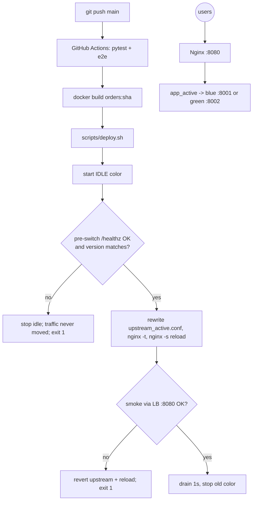

# bluegreen-deploy: GitHub Actions + Docker + Nginx with automatic rollback

> **Lab project.** The "orders" service is a 20-line FastAPI app. The point is the release mechanics, not the app.

## Problem
Restarting a service in place causes downtime, and a bad release stays live until someone notices. Blue-green keeps two copies. The new version goes to the **idle** color and is **health-checked before any traffic moves**. Nginx then switches upstream with a graceful `reload` (no dropped connections), a post-switch smoke test runs through the load balancer, and any failure **rolls back automatically**.

## Architecture


## Run
```bash
sudo apt-get install -y nginx            # used as an unprivileged process; no root needed to run
python3 -m venv .venv && .venv/bin/pip install -r requirements-dev.txt
PATH=/usr/sbin:$PATH .venv/bin/pytest -q # unit + full e2e
PATH=/usr/sbin:$PATH PYTHON=.venv/bin/python scripts/e2e.sh
# manual
PYTHON=.venv/bin/python scripts/deploy.sh v1; scripts/deploy.sh v2; scripts/deploy.sh v3 --fail-health
MODE=docker scripts/deploy.sh <tag>      # containers instead of local processes (needs orders:<tag> image)
scripts/teardown.sh
```

## Results (actual run, 2026-10-11, lab box, nginx 1.26.3, MODE=local)
`results/e2e.log`, `results/deploy.log`, `results/pytest.log`:

| Scenario | Outcome |
|---|---|
| v1 → blue (first deploy) | PASS |
| v2 → green **under load** (~80 req/s) | PASS: **501 requests, 0 errors**; 131 served by v1 and 370 by v2 |
| v3 with failing `/healthz` | PASS: pre-switch check failed after 10×0.5 s, script exited 1, traffic stayed on v2 |
| v4 after rollback | PASS: switched to blue |
| pytest | **3 passed** (2 unit + e2e) |

**Not run:** `MODE=docker` and the GitHub Actions workflow, because the box has no Docker daemon. The local-process mode exercises the same Nginx switch and rollback logic.

**Bugs I hit and fixed:** (1) In bash, `(cd dir && cmd &)` backgrounds the whole `&&` list, so `$!` was the subshell's PID and `kill` left uvicorn orphaned holding the port. The next deploy then failed to bind, and the health check "correctly" failed for the wrong reason. (2) The first deploy marked blue active before anything was running.

## Limitations
- Single host. Real setups put the LB on a separate box, or use an ALB with weighted target groups or a K8s Service selector switch.
- No DB migration strategy. Blue-green needs backward-compatible (expand/contract) schema changes.
- The post-switch check is a single smoke test, not a canary with error-rate SLO analysis (e.g. Argo Rollouts).
- The "deploy" job on a GitHub-hosted runner is a demo. Production would use a self-hosted runner or SSH to the target.

## Sources
- Martin Fowler, BlueGreenDeployment: https://martinfowler.com/bliki/BlueGreenDeployment.html
- Nginx graceful reload (control signals): https://nginx.org/en/docs/control.html
- `proxy_next_upstream`: https://nginx.org/en/docs/http/ngx_http_proxy_module.html#proxy_next_upstream
